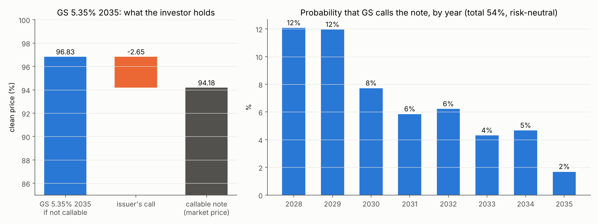
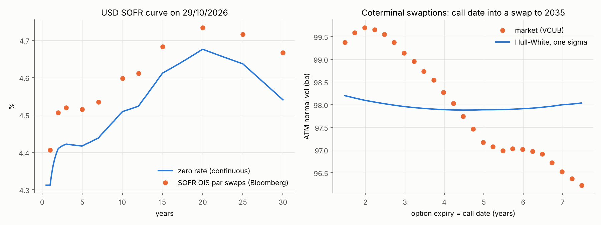
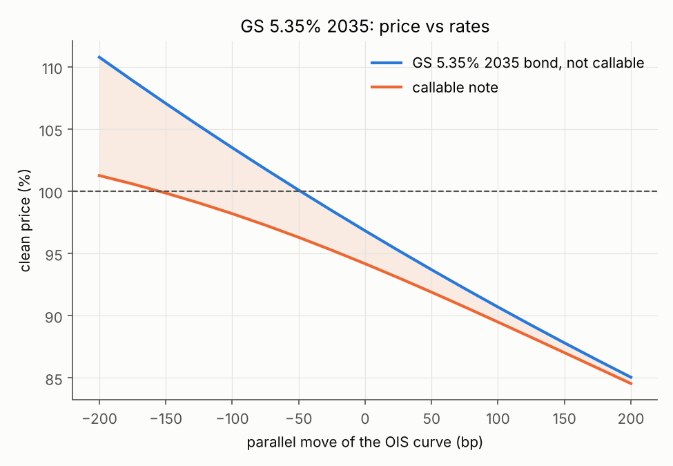
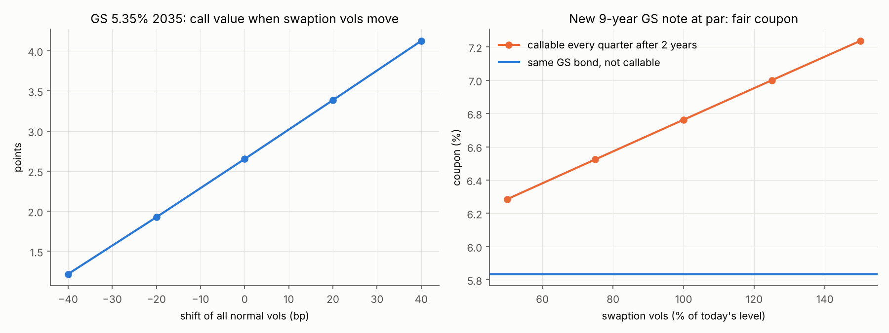
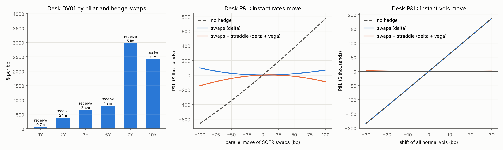
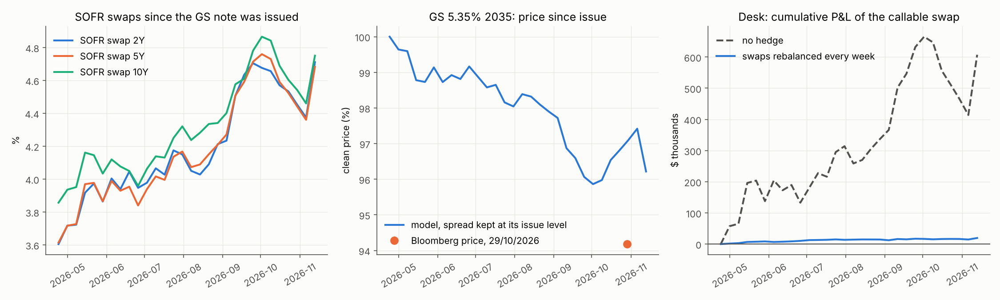

# Goldman Sachs 5.35% 2035 Callable Note: Pricing the Issuer's Call and Hedging It

Goldman Sachs issued this note in April 2026: a 5.35% fixed coupon for 9 years, but GS can repay it at par every
quarter from April 2028. I priced it on Bloomberg data from 29 October 2026 to answer four questions:

1. **Structuring.** How much is the issuer's call worth, and how does it explain the coupon?
2. **Sales.** What does the call change for the client?
3. **Trading.** The desk that swaps the note with GS ends up long the call: what risks does it keep, and how does it hedge them?
4. **Since issue.** What happened to the note and to the desk's hedge from April to November 2026?



**In short:**
- The call is worth **2.65 points**, or 40bp a year that the client gives back to GS. The note trades at 94.18;
  a non-callable GS bond with the same coupon, maturity and spread would be worth 96.83.
- There is a 54% (risk-neutral) chance that GS calls the note, which cuts its expected life from 8.5 to 6.0 years.
- The call caps the price when rates fall: -100bp on rates gives +4.0 points, against +6.7 for a non-callable GS bond with the same coupon and maturity.
- Volatility pays the coupon: a new 9-year GS note callable after 2 years should pay 6.76%, against 5.84% without the call.
- The desk is long a Bermudan swaption worth $458k. Swaps remove the rate risk and swaption straddles remove the vol risk,
  but the desk is left with a gamma risk of $90-145k for a 100bp move.
- Since issue, SOFR rates rose by about 100bp. The client has lost about 6 points (half rates, half GS's wider spread).
  An unhedged desk would be up $607k. With swaps rebalanced every week, its P&L moves by only $1.7k a week.

## The note

| | |
|---|---|
| Issuer | The Goldman Sachs Group, senior unsecured (A2 / BBB+ / A) |
| ISIN | US38151FYA55, USD 15.853m, issued at 100 on 21/04/2026 |
| Coupon | 5.35% fixed, semi-annual, 30/360 |
| Maturity | 21/04/2035 |
| Call | GS can repay at par (+ accrued coupon) every 21 January, April, July and October, from 21/04/2028 to 21/01/2035: 28 dates |
| Price on 29/10/2026 | 94.18 (yield 6.24%) |

The client is short a Bermudan swaption: GS calls when it can refinance below 5.35%, that is when rates have fallen,
which is exactly when the client would like to keep the coupon.

## Data and method

| Data (Bloomberg, 29/10/2026) | Used for |
|---|---|
| SOFR OIS swaps 1Y to 30Y | discount curve |
| USD swaption ATM normal vol cube (VCUB) | calibration of the model |
| GS note: price, schedule of call dates (DES) | OAS, call value |
| SOFR swaps 2Y, 5Y, 10Y every week since April 2026 | the note and the desk since issue |

- **Model.** One-factor Hull-White, dr = (theta(t) - a r) dt + sigma dW, with a = 3%. Sigma is calibrated on the
  **coterminal swaptions**: an option expiring on a call date, on a swap ending in 2035. These are the European options
  hidden in the call.
- **Pricing.** Hull-White trinomial tree fitted to the SOFR curve. Going back from maturity, on each call date GS calls
  if the rest of the note is worth more than par.
- **Spreads.** The Z-spread is the spread over SOFR that gives the market price without the call. The **OAS** is the same
  spread with the call priced in. Z-spread - OAS is the cost of the call in bp a year.

## 1. Structuring: what the call is worth



The SOFR curve goes from 4.41% (1Y) to 4.73% (20Y). The coterminal swaption vols are 96-100bp. One sigma fits them
within 2bp, but it cannot follow their slope from 99.7bp (2028) to 96.2bp (2034).

| | |
|---|---|
| Z-spread (no call) | 168bp |
| OAS (with the call) | 128bp |
| Cost of the call | 40bp a year |
| Same GS bond if it were not callable (same coupon, maturity and spread) | 96.83 |
| Call value | **2.65 points** |
| Probability of a call | 54% (12% in 2028, 12% in 2029, then less each year) |
| Expected life | 6.0 years (8.5 to maturity) |

The 128bp OAS is GS's credit spread on this small retail note. It is high for an A-rated bank, because the note is
illiquid and priced by Bloomberg (IBVL, bid/ask 93.35 / 95.01).

## 2. Sales: what the call changes for the client



| | Callable note | Same GS bond, not callable |
|---|---|---|
| Rates -100bp | +4.0 points | +6.7 points |
| Rates +100bp | -4.7 points | -6.1 points |
| Effective duration | 4.6 | 6.6 |

The client loses almost as much as with a normal bond when rates rise, but gains much less when they fall:
the note would be called, and the client would have to reinvest at lower rates. The 6.24% yield to maturity is only
earned if the note is not called.



The client is short vol: +20bp of swaption vol adds 0.73 points to the call. For a new issue, the coupon is paid by the
vol. A new 9-year GS note callable quarterly after 2 years should pay 6.76% at today's vols, against 5.84% for a bullet
bond: the call is worth 92bp of coupon a year. With vols 50% higher it would pay 7.24%.

## 3. Trading: the desk's view

GS does not keep fixed-rate callable debt. It swaps it with a desk: the desk pays the 5.35% coupon, receives
SOFR + GS's funding spread, and can cancel the swap on every call date. When the desk cancels, GS calls the note.

Paying 5.35% and receiving SOFR + 128bp is the same as paying 4.07% against SOFR. So the desk is:
**pay fixed 4.07% to 2035 + the right to cancel = long a Bermudan receiver swaption**, worth 2.89 points ($458k).
The desk pays GS for this option through the funding spread.



| Risk | Size | Hedge |
|---|---|---|
| Rates (DV01) | +$7.3k per bp, mostly 7Y and 10Y | receive fixed: 0.7m 1Y, 2.1m 2Y, 2.4m 3Y, 1.8m 5Y, 5.1m 7Y, 3.1m 10Y |
| Vols (vega) | +$6.2k per bp of normal vol | sell 11.6m of ATM 1.5y x 7y straddles (first call date into the swap to 2035) |
| Gamma | long with the swaps only, short after the straddles | not hedged |

- **No hedge:** a 100bp move costs or makes $660-770k.
- **Swaps:** the P&L is flat for small moves and positive for large ones (+$70-100k at 100bp). The desk is long an
  option, so it is long gamma.
- **Swaps + straddles:** the vol risk is gone (under $2k for a 30bp vol move), but a European straddle has more gamma than
  the Bermudan for the same vega. The desk is now short gamma (-$90k to -$145k at 100bp).

A Bermudan is not a sum of European options, so one vega hedge cannot match gamma and vega at once. Desks use a strip
of coterminal swaptions and re-hedge often. Because banks are long vol through all these callables, they keep selling
long-dated swaption vol in the market.

## 4. Since issue: April to November 2026



I repriced the note and the desk's swap every week from 24/04/2026 to 13/11/2026 with the weekly SOFR swaps 2Y, 5Y
and 10Y. There is no history of swaption vols, so the vols stay at their 29/10 level.

- **Spread at issue.** The note priced at 100 on day one with a spread of 65bp over SOFR. On 29/10 the OAS is 128bp.
- **Client.** SOFR swaps went from 3.6% to 4.4-4.7%. With the spread unchanged the note would be at 97.1 on 29/10, and
  the market price is 94.2: about 3 points come from rates and 3 points from GS's wider spread. Higher rates also made
  the call less likely (77% at issue, 67% at the end of October with the issue spread).
- **Desk.** The desk pays fixed, so it gains when rates rise: +$607k without hedge, with weekly swings of $64k.
  With 2Y, 5Y and 10Y swaps rebalanced every Friday, the weekly P&L moves by only $1.7k and ends at +$20k: the gamma of
  the Bermudan, earned on each re-hedge. The coupons exchanged on the swap (the carry) are left out.

## Run it

```bash
pip install -r requirements.txt
python run_analysis.py      # about 15 seconds, 7 charts and the tables in results/
python -m pytest -q         # 7 tests on the curve, the tree and the note
```

The Bloomberg quotes are licensed, so `data_bloomberg/` is not in the repository (`.gitignore`). The charts and tables
in `results/` are my outputs.

Code: `callnote/curve.py` (SOFR curve), `hull_white.py` (calibration and tree), `notes.py` (the note),
`pricing.py` (OAS, call value, probabilities), `desk.py` (callable swap and hedge), `history.py` (since issue), `plots.py`.
